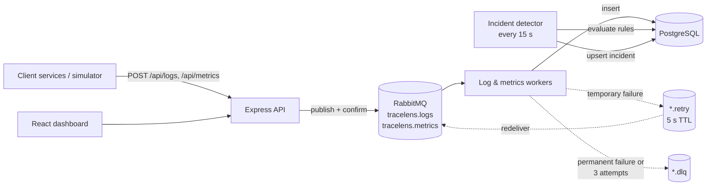

# TraceLens — Asynchronous API Monitoring & Incident Detection

[](https://github.com/NikhilMannem/tracelens/actions/workflows/ci.yml)

TraceLens is a monitoring platform that ingests application logs and metrics asynchronously, detects error bursts and metric anomalies with configurable rules, and tracks incidents through a web dashboard.

## Features

- REST API for application logs, metrics, services, and incidents
- RabbitMQ-based asynchronous processing with publisher confirms and manual acks
- Bounded retries with delay and a dead-letter queue for failed messages
- PostgreSQL storage with schema migrations applied automatically on first start
- Configurable incident rules (`ERROR_COUNT`, `METRIC_AVG`) stored in the database
- Incident deduplication through a partial unique index
- React dashboard with incident filtering and status actions
- Docker Compose deployment and GitHub Actions CI

## Technology Stack

- **Frontend:** React, TypeScript, Vite
- **Backend:** Node.js, Express, TypeScript
- **Database:** PostgreSQL
- **Message broker:** RabbitMQ
- **Workers:** Node.js, TypeScript
- **Deployment:** Docker and Docker Compose

## Architecture



1. Applications submit logs and metrics through the API.
2. The backend validates the payload, publishes it to RabbitMQ, and returns `202 Accepted` only after the broker confirms the message.
3. Workers consume messages and persist them to PostgreSQL, acknowledging each message only after a successful write.
4. The incident detector evaluates the enabled rules in `incident_rules` and opens or escalates incidents when thresholds are reached.
5. Operators investigate and resolve incidents through the dashboard.

## Reliability

| Failure | Handling |
|---|---|
| Database temporarily unavailable | Message moves to a `*.retry` queue and is redelivered after 5 s, up to 3 attempts |
| Still failing after 3 attempts | Message is parked in `*.dlq` with the error and failure time in its headers |
| Malformed payload or unknown service | Sent straight to `*.dlq` (retrying would never succeed) |
| Worker crashes mid-processing | Unacked message is redelivered by RabbitMQ |
| Repeated detections for the same problem | A partial unique index on `(service_id, title)` for active incidents keeps one open incident, escalating severity instead of duplicating |

A message is acknowledged only after the broker has confirmed its copy in the retry or dead-letter queue, so a crash produces at worst a duplicate and never a lost message. Without this, a single failing message was requeued immediately and retried forever.

## Performance

Detector query (`COUNT` of ERROR logs for one service in a time window), measured with `EXPLAIN ANALYZE` on 1,000,000 log rows, median of 7 runs:

| Window | No index | `(service_id, occurred_at)` index | + partial index `WHERE level = 'ERROR'` |
|---|---|---|---|
| 1 minute | 339 ms | 0.13 ms | 0.21 ms |
| 60 minutes | 436 ms | 5.0 ms | 2.1 ms |
| 24 hours | 237 ms | 110 ms | 64 ms |

The partial index is 3 MB compared with 30 MB for a full index on the same columns, because only ERROR rows are indexed.

Load test with 50 concurrent clients for 30 s (`autocannon`, run inside the Docker network): every accepted log (2,165 of 2,165) was persisted, and the queue drained within about 2 s of the test ending. Absolute throughput was limited by the Docker Desktop VM on the test laptop, so it is not reported here.

## Prerequisites

- Node.js and npm for local development
- Docker Desktop with Docker Compose
- Git

## Run with Docker

Clone the repository, enter the project directory, and create your `.env` from the example:

```powershell
copy .env.example .env
```

Build and start the stack. On the first start, Postgres applies every file in `backend/sql` in order, creating the schema, demo services, and default incident rules:

```powershell
docker compose up -d --build
```

Inspect container status:

```powershell
docker compose ps
```

View application logs:

```powershell
docker compose logs --tail=100 backend log-worker metrics-worker
```

Stop the stack:

```powershell
docker compose down
```

This preserves named database volumes. To remove persisted data as well, Docker volumes must be explicitly removed; do so only when you intend to erase stored data.

Generate traffic, or trigger an incident on demand:

```powershell
cd simulator
npm install
npx tsx src/index.ts            # steady traffic
npx tsx src/index.ts --burst    # 12 ERROR logs, opens a CRITICAL incident
```

The SQL files only run against an empty database. For an existing database, apply new files manually, for example:

```powershell
Get-Content backend/sql/004_error_logs_partial_index.sql | docker exec -i tracelens-postgres sh -c 'psql -U "$POSTGRES_USER" -d "$POSTGRES_DB"'
```

## Local Development

Start the backend:

```powershell
cd backend
npm install
npm run dev
```

Start the frontend in another terminal:

```powershell
cd frontend
npm install
npm run dev
```

Start the workers in separate terminals:

```powershell
cd workers
npm install
npm run dev
```

For the metrics worker, use:

```powershell
npm run dev:metrics
```

Local development requires PostgreSQL, RabbitMQ, and the root environment variables to be configured and reachable.

## Service URLs

| Component | URL |
|---|---|
| Dashboard (Docker) | http://localhost:8081 |
| Backend health | http://localhost:3000/health |
| Incident API | http://localhost:3000/api/incidents?limit=100 |
| RabbitMQ management (queues, DLQ) | http://localhost:15672 |
| PostgreSQL host port | `5433` |

Port mappings can vary depending on the local environment and Compose configuration.

## API Overview

| Method | Endpoint | Purpose |
|---|---|---|
| GET | `/health` | Health check |
| GET | `/api/services` | List services |
| GET | `/api/services/:name` | Get service details |
| POST | `/api/validate-log` | Validate a log payload |
| POST | `/api/logs` | Submit a log asynchronously |
| GET | `/api/logs` | Retrieve persisted logs |
| GET | `/api/incidents` | List incidents |
| GET | `/api/incidents/:id` | Get incident details |
| PATCH | `/api/incidents/:id/status` | Update incident status |

Incident transitions supported by the current implementation include `OPEN → INVESTIGATING`, `OPEN → RESOLVED`, and `INVESTIGATING → RESOLVED`.

## Testing and Build

Run backend tests and TypeScript checks:

```powershell
cd backend
npm test
npm run typecheck
npm run build
```

Build the frontend:

```powershell
cd frontend
npm run build
```

Build the workers:

```powershell
cd workers
npm run build
```

## Example Incident Scenario

1. Submit repeated `ERROR` logs for a registered service.
2. Confirm the log worker persists the messages.
3. Wait for the incident detector to evaluate recent errors.
4. Inspect the generated incident in the API or dashboard.
5. Mark the incident as `INVESTIGATING`.
6. Resolve it and verify that `resolved_at` is populated.

The detector's configured threshold and evaluation window determine when an incident is generated.

## Security and Configuration

- Keep `.env` files and credentials out of version control.
- Change development-only credentials before any shared or production deployment.
- Configure allowed CORS origins for the intended deployment environment.
- Add authentication and authorization before exposing management or incident APIs publicly.
## Project Status

The core API, asynchronous processing pipeline with retries and dead-lettering, configurable incident rules, dashboard, Docker deployment, and CI are implemented and verified. Authentication and a dead-letter replay endpoint are the next areas for improvement.
